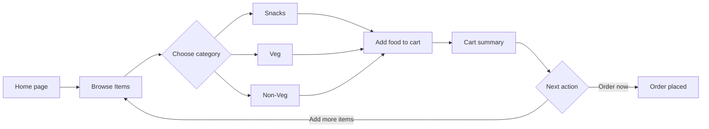

# Rest0renT

A responsive restaurant menu and shopping cart website built with plain HTML, CSS, and JavaScript. Users can browse food categories, add items to a cart, review their order, and continue to the order confirmation page.

> This is a front-end demonstration project. It has no server, database, payment gateway, or real order-processing API. Cart data is saved in the browser with `localStorage`.

## Live Project

- GitHub: [DuddeJaitej/Restorent](https://github.com/DuddeJaitej/Restorent)
- Live site: [restorent-xvav.vercel.app](https://restorent-xvav.vercel.app/)
- Deployment: Import the repository into [Vercel](https://vercel.com/) using the `main` branch.

## Features

- Responsive home page with hero and contact sections
- Food browsing pages for items, snacks, vegetarian food, and non-vegetarian food
- Add-to-cart flow using browser `localStorage`
- Cart summary with item prices, total price, and remove actions
- Order confirmation page
- Responsive navigation menu for smaller screens
- Static deployment with no build process required

## User Flow



## Pages

| Page | File | Purpose |
| --- | --- | --- |
| Home | `index.html` | Landing page and restaurant introduction |
| Items | `Items.html` | Main food category selection |
| Snacks | `Snacks.html` | Snacks and junk food menu |
| Veg | `Veg.html` | Vegetarian menu |
| Non-Veg | `NonVeg.html` | Non-vegetarian menu |
| Cart | `cart.html` | Review, remove, and total cart items |
| Order placed | `OrderPlaced.html` | Order confirmation screen |
| About | `About.html` | Restaurant information |

## Project Structure

```text
Restorent/
|-- index.html                 # Vercel and local entry point
|-- Items.html                 # Main menu
|-- Snacks.html                # Snacks menu
|-- Veg.html                   # Vegetarian menu
|-- NonVeg.html                # Non-vegetarian menu
|-- cart.html                  # Shopping cart
|-- OrderPlaced.html            # Confirmation page
|-- About.html                 # About page
|-- Restaurant.css             # Home page styles
|-- Items.css                  # Items page styles
|-- Snacks.css                 # Snacks page styles
|-- Veg.css                    # Vegetarian page styles
|-- NonVeg.css                 # Non-vegetarian page styles
|-- cart.css                   # Cart page styles
|-- OrderPlaced.css            # Confirmation page styles
|-- About.css                  # About page styles
|-- responsive.css             # Shared responsive styles
|-- responsive.js              # Mobile navigation behavior
|-- CartscriptFile.js          # Add-to-cart and localStorage logic
|-- Images/                    # General page images
|-- FoodImages/                # Menu and interface images
|-- Restaurant.html            # Legacy redirect to index.html
```

The repository also contains a nested `Restaurant/` directory with older copies of several files. Use the top-level directory containing `index.html` when running locally or configuring Vercel.

## Requirements

You only need:

- A modern browser such as Chrome, Edge, Firefox, or Safari
- Git, if you are cloning the repository
- Optional: VS Code with the **Live Server** extension for a local development server

No Node.js, npm, Python, database, or environment variables are required.

## Run Locally

### Option 1: Open directly in a browser

1. Clone or download this repository.
2. Open the top-level project folder.
3. Double-click `index.html`.

Some browser features, including `localStorage`, work more reliably through a local server.

### Option 2: VS Code Live Server

1. Open the top-level `Restorent` folder in VS Code.
2. Install the **Live Server** extension by Ritwick Dey.
3. Open `index.html`.
4. Right-click inside the file and select **Open with Live Server**.
5. Open the URL shown by VS Code, usually `http://127.0.0.1:5500/`.

### Option 3: Python local server

If Python is installed, run this command from the top-level project folder:

```bash
python -m http.server 8000
```

Then open [http://localhost:8000](http://localhost:8000) in your browser. Stop the server with `Ctrl+C`.

## Test the Cart

1. Open the home page and select **Items**.
2. Open a food category.
3. Add one or more foods to the cart.
4. Open `cart.html` through the cart icon or navigation.
5. Confirm the images, item names, prices, and total.
6. Use **Remove** to delete an item, or **Order Now** to open the confirmation page.

Cart contents belong to the current browser and origin. Clearing site data or using a different browser removes or changes the saved cart.

## Deploy with Vercel

1. Push the project to GitHub.
2. Sign in to [Vercel](https://vercel.com/) with GitHub.
3. Select **Add New -> Project**.
4. Import `DuddeJaitej/Restorent`.
5. Select the `main` branch.
6. Set **Framework Preset** to `Other`.
7. Set **Root Directory** to the repository root (`./`).
8. Leave **Build Command**, **Output Directory**, and **Environment Variables** empty.
9. Click **Deploy**.

Vercel detects `index.html` as the homepage. Every push to `main` creates a new deployment automatically.

## Git Workflow

```bash
git clone https://github.com/DuddeJaitej/Restorent.git
cd Restorent

# After making changes:
git add .
git commit -m "Describe your change"
git push origin main
```

## Troubleshooting

### The deployed site shows 404

Confirm that:

- Vercel is connected to `DuddeJaitej/Restorent`.
- The production branch is `main`.
- The Root Directory is `./`.
- `index.html` exists in the repository root.
- The latest deployment completed successfully.

### Images do not appear

Run the site from the top-level folder and preserve the `Images/` and `FoodImages/` directory names. Asset paths are relative and case-sensitive on many hosting platforms.

### The cart is empty

Add an item from a menu page in the same browser and same site origin. The cart is intentionally stored only in browser `localStorage`.

## Contributing

1. Create a feature branch.
2. Make and test your changes locally.
3. Commit with a clear message.
4. Push the branch and open a pull request.

## License

No license has been specified for this project yet.
